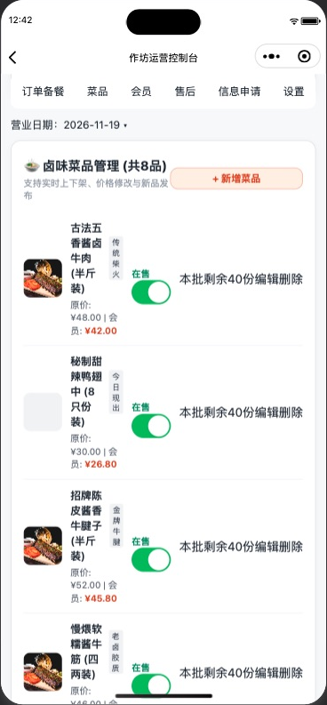
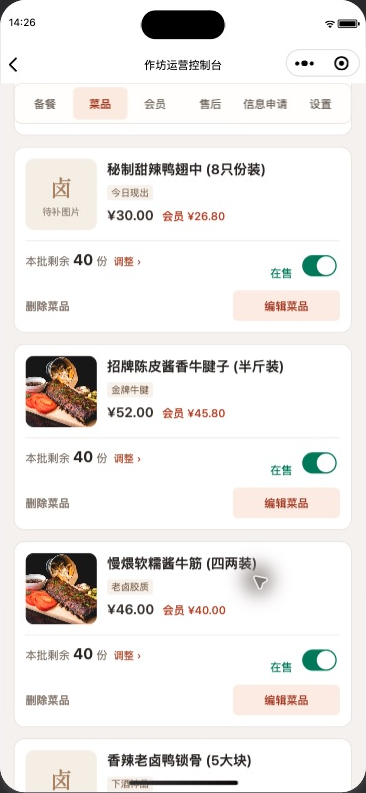

# 主页面 UI 优化与视觉验收

日期：2026-11-19。项目：潘小兜老卤。

## 本轮完成范围

统一为暖纸色背景、砖红主色、白色卡片和适度留白，按“身份/状态—核心信息—操作”组织内容。直接修改原生小程序页面，未引入外部商城源码。

| 页面 | 改动 | 实际视觉检查 |
| --- | --- | --- |
| 点餐首页 | 店名完整展示；配送方式与批次分层；菜品图文、会员价、库存、数量操作重新排版；缺图占位；结算表单层级 | 430px 首页，320px 商品列表及结算抽屉顶部/底部 |
| 会员中心 | 身份卡、入会进度、资产入口、双账户与权益卡片统一；长昵称和说明可换行 | 430px 普通身份；320px 有余额会员身份 |
| 街坊邀请 | 邀请码和分享操作分区；主要按钮独占一行；奖励公式分行；统计与空列表统一 | 430px 非会员状态；320px 会员分享区、公式和统计 |
| 我的订单 | 标题与筛选；订单状态、批次、金额、明细和操作分区；重做空状态 | 430px 空状态；320px 待付款双商品订单、展开账单和关闭状态 |
| 掌柜工作台 | 菜名被挤成竖排的问题修复；图片/名称/价格、库存/上架、编辑/删除分行；导航与待办简化；会员指标及设置表单适配 | 430px 菜品列表；320px 菜品、编辑弹窗、备餐待办、会员、经营设置 |

## 验收方法与发现

使用正在运行的微信开发者工具 Stable 2.02.2608080，基础库 3.18.0，实际加载本项目 WXML/WXSS 和本机 API 数据，并逐页截图检查。机型为 iPhone 15 Pro Max（430×932）及 iPhone 5（320×568），字体设置 16。

窄屏复验发现并修复了邀请按钮重叠、微信原生按钮默认尺寸盖过页面样式、设置输入框文字裁切；修复后重新编译并返回页面复验。检查了长菜名、缺图、数量与金额、空状态和滚动后底部操作。商品编辑只打开和取消，没有保存业务数据。

为了验收非空订单，在本机独立数据库为测试会员创建了一笔标注“本机UI验收测试”的未付款订单，含两种商品、应付 ¥68.80；该订单已超时关闭（状态 60），未发起真实付款。保留关闭记录用于后续联调。生产环境未部署本轮 UI。

`git diff --check` 与管理页 JavaScript 语法检查通过；验收时开发者工具 Errors 为 0。工具仍有灰度基础库、开发模式域名检查、资源预加载/worker 及部分既有 WXSS 选择器提示，不等于零告警验收。

本轮为开发者工具实际页面视觉验收，尚未进行 iOS/Android 真机、系统放大字体、微信原生支付及已付款取餐码的完整复验。现有商品图片含重复联调素材，正式营业前应替换为对应实拍商品图。

## 实际截图

截图从开发者工具原始截图裁出小程序显示区域，未合成或重绘页面；原始整窗截图与修改前源码留存在 `.runtime/ui-review-20261119/`。

### 掌柜菜品页改前 / 改后

### 各页验收证据

- [首页 430px](ui-review-2026-11-19/index-after.png) / [商品列表 320px](ui-review-2026-11-19/index-products-320.png)
- [结算表单 320px](ui-review-2026-11-19/checkout-320.png) / [结算底部 320px](ui-review-2026-11-19/checkout-bottom-320.png)
- [会员中心 430px](ui-review-2026-11-19/member-after.png) / [会员身份 320px](ui-review-2026-11-19/member-vip-320.png)
- [非会员邀请页 430px](ui-review-2026-11-19/promote-after.png) / [会员邀请 320px](ui-review-2026-11-19/promote-vip-320.png) / [奖励公式 320px](ui-review-2026-11-19/promote-formula-320.png)
- [订单空状态 430px](ui-review-2026-11-19/order-after.png) / [待付款订单 320px](ui-review-2026-11-19/order-pending-320.png) / [展开明细 320px](ui-review-2026-11-19/order-detail-320.png)
- [菜品管理 320px](ui-review-2026-11-19/admin-products-320.png) / [编辑弹窗 320px](ui-review-2026-11-19/admin-editor-320.png)
- [备餐待办 320px](ui-review-2026-11-19/admin-orders-320.png) / [会员管理 320px](ui-review-2026-11-19/admin-members-320.png) / [经营设置 320px](ui-review-2026-11-19/admin-settings-320.png)

## 后续视觉完善顺序

1. 更换对应商品的实拍封面，统一裁切和光线；现有缺图占位可继续兜底。
2. 按同一视觉规范继续处理资产流水、交易规则、售后、隐私申请与经营日报等次级页面。
3. 正式账号可真机预览后补做 iOS/Android、放大字体、键盘弹出与已付款自提状态验收。
